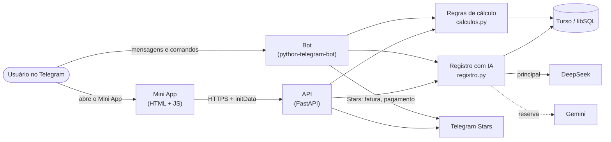
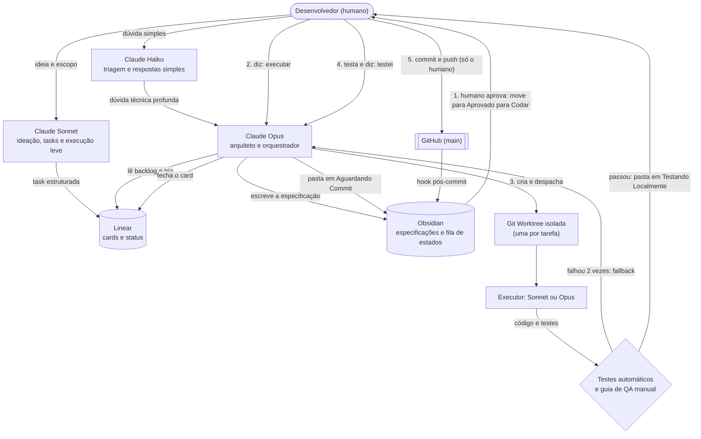

# L1d3r (Fin4nce): assistente financeiro no Telegram

Bot e **Telegram Mini App** para registrar gastos e receitas em linguagem natural, acompanhar a fatura do cartão, a Sobra do Mês e as categorias, com **assinatura paga em Telegram Stars**. O projeto também é um estudo de caso de **engenharia assistida por IA generativa**: toda a esteira de desenvolvimento (triagem, especificação, código, teste e commit) é orquestrada por agentes Claude, com aprovação humana obrigatória (veja a [seção 2](#2-arquitetura-de-desenvolvimento-e-fluxo-agêntico-ia-generativa)).

---

## Sumário

1. [Visão geral do projeto](#1-visão-geral-do-projeto)
2. [Arquitetura de desenvolvimento e fluxo agêntico (IA generativa)](#2-arquitetura-de-desenvolvimento-e-fluxo-agêntico-ia-generativa)
3. [Estrutura do projeto e como executar](#3-estrutura-do-projeto-e-como-executar)

---

## 1. Visão geral do projeto

### O problema

Controlar gastos costuma exigir planilhas e telas cheias de campos. O L1d3r resolve isso dentro do app que a pessoa já usa todos os dias: ela escreve algo como `almoço 32 no restaurante`, e a IA identifica o valor, a categoria e a data; a pessoa só confirma. O painel mostra, em tempo real, quanto já foi gasto na fatura atual, quanto sobra por categoria e o que ainda vai vencer.

### Principais funcionalidades

- **Registro por linguagem natural:** a IA interpreta o texto, classifica o gasto entre as categorias ativas da própria pessoa (mapeando sinônimos) e mostra uma prévia antes de gravar. Gravações são idempotentes (chave de registro), então um toque duplo não duplica o gasto.
- **Mini App completo:** home com o gasto do mês, a **Sobra do Mês**, gráfico e últimas movimentações; telas de Registrar, Recorrentes, Categorias e Assinaturas, em um único arquivo HTML sem etapa de build.
- **Cartão e fatura:** ciclo de fatura com dia de fechamento, parcelamentos, receitas e cálculo de orçamento e sobra por categoria, com regras centralizadas em um módulo (`calculos.py`) usado igualmente pelo bot e pela API.
- **Gastos e receitas recorrentes**, com alertas diários agendados no fuso de Brasília.
- **Assinaturas com Telegram Stars:** teste grátis de 10 dias (uma vez por pessoa), plano Pro de 150 Stars a cada 30 dias com renovação automática, cancelamento e reativação pelo Mini App, pagamentos idempotentes (o recibo é gravado antes do processamento) e **modo somente leitura** quando a assinatura vence (os dados continuam visíveis por 12 meses).
- **Limites e proteção de custo:** limite diário de registros por IA, limite por minuto, trava de cadastro (`CADASTRO_ABERTO`) e limite diário de testes novos.
- **Administração pelo próprio bot:** comandos restritos a administradores para conceder ou retirar Pro, estender testes, reembolsar e enviar avisos de vencimento. O administrador é identificado apenas pelo ID do Telegram validado no servidor, nunca pelo cliente.
- **Experiência nativa no celular:** tela cheia imersiva (com áreas seguras do aparelho), aviso nativo de "Adicionar à tela inicial" e abertura direta por link do Main Mini App.
- **IA com reserva:** o registro usa o **DeepSeek** como modelo principal e o **Google Gemini** como reserva automática se o principal falhar ou demorar mais que o limite.

### Stack tecnológica

| Camada | Tecnologia |
|---|---|
| Linguagem | Python 3.13 |
| Bot | `python-telegram-bot` (com `JobQueue`) |
| API | FastAPI + Uvicorn, validação do `initData` do Telegram (HMAC) |
| Mini App | HTML, CSS e JavaScript puro, em um único arquivo (`mini-apps/home/index.html`) |
| Banco de dados | Turso (libSQL), via biblioteca `libsql` |
| IA de registro | DeepSeek (principal) e Google Gemini (`google-genai`, reserva) |
| Pagamentos | Telegram Stars (moeda `XTR`) |
| Hospedagem | Discloud (um único app que sobe bot e API) |
| Testes | Suítes `testes_*.py` em Python, com testes de caracterização (golden master) |
| Automação do fluxo | Linear, Obsidian, Git Worktrees e um hook de pós-commit |

### Visão do sistema



---

## 2. Arquitetura de desenvolvimento e fluxo agêntico (IA generativa)

Este sistema foi projetado, desenvolvido e é mantido por uma **esteira de engenharia assistida por IA**. Os agentes escrevem e testam o código, mas **nenhuma linha é gerada sem especificação aprovada por um humano**, e **só o desenvolvedor faz commit e push**.

### 2.1 Orquestração multiagente no Orca

O trabalho é dividido entre os modelos da família Claude de acordo com a complexidade e o custo de cada etapa:

| Modelo | Papel na esteira |
|---|---|
| **Claude Haiku** | Triagem rápida e respostas a mensagens simples no chat. Quando a pergunta exige profundidade técnica sobre o funcionamento do sistema, o próprio Haiku reconhece a complexidade e **escala automaticamente para o Opus**. |
| **Claude Sonnet** | **Ideação inicial**, estruturação das tasks e execução de tarefas visuais ou de menor complexidade lógica e matemática. É o executor padrão das tarefas dentro dos worktrees. |
| **Claude Opus** | **Arquiteto principal e orquestrador**: faz a triagem das demandas, escreve as especificações, despacha e revisa o trabalho dos executores, assume as tarefas de alto risco (núcleo do bot, regras de cálculo, segurança e segredos) e responde as dúvidas técnicas aprofundadas escaladas pelo Haiku. |

**Protocolo de fallback (regra do `CLAUDE.md`):** se o executor falhar nos testes **duas vezes seguidas no mesmo bug**, ele é removido da tarefa e o **Opus assume o controle** para reescrever, testar e validar a solução, evitando loops de tokens. O resgate é documentado na nota da tarefa.

**Executor por tarefa:** toda especificação declara se o executor será Sonnet (padrão) ou Opus. Com executor Opus, o Opus principal ainda **revisa o diff completo** contra a especificação e roda os testes por conta própria antes de liberar o teste humano.

### 2.2 Gestão e máquina de estados (Linear + Obsidian)

As demandas nascem como cards no **Linear** (colunas `Ideias / Backlog`, `Fila de Tarefas`, `Em Processo`, `Testando Localmente`, `Aguardando Commit`, `Concluidos` e `Bugs`). O Opus lê o Linear pelo terminal, tria cada card e o transforma em uma **especificação técnica concisa no Obsidian**, que funciona como "segundo cérebro" do projeto e como a **fila de estados**: cada tarefa é uma pasta que anda inteira pelas etapas.

```text
Fila de Tarefas ──► Aprovado para Codar ──► Testando Localmente ──► Aguardando Commit ──► Implantacoes Concluidas
   (Opus tria e        (HUMANO move a         (testes do executor     (HUMANO commita)        (hook pós-commit
    especifica)         pasta: aprovação)       ok + guia de QA)                                move a pasta)
```

- **Triagem:** o Opus cria a pasta da tarefa em `Fila de Tarefas` com a especificação (escopo, pré-condições, requisitos técnicos, arquivos previstos e dependências, nível de teste humano, executor, critérios de aceite e fora do escopo). Itens a conferir seguem o formato *pergunta + caixa de verificação*.
- **Human-in-the-Loop obrigatório:** durante a triagem, agentes são **proibidos de tocar em código**. O gatilho da execução é um evento físico: o desenvolvedor move a pasta para `Aprovado para Codar` e diz "executar".
- **Níveis de teste humano:** `NENHUM`, `RÁPIDO` (até 3 passos) ou `COMPLETO` (guia de QA passo a passo, gerado pelo agente, com o comando exato, o resultado esperado e o que fazer se falhar). Tarefas que mexem em valores financeiros, no esquema do banco ou em algo visível nunca usam `NENHUM`.
- **Fechamento:** com todos os itens do guia marcados ("testei"), o Opus move a pasta para `Aguardando Commit` com a mensagem de commit pronta. Depois do commit, um **hook de pós-commit** (`.githooks/post-commit` + `atualizar_fluxo.py`) move a pasta para `Implantacoes Concluidas` e pinta o card da tarefa de verde na linha do tempo (um Canvas do Obsidian); o Opus então fecha o card no Linear.

### 2.3 Isolamento e governança de código (Git Worktrees)

- Cada funcionalidade ou correção é desenvolvida em uma **Git Worktree isolada**, com a própria branch, para proteger a `main` de erros ou bugs gerados pelos agentes. Tarefas independentes rodam em paralelo; tarefas que compartilham arquivos (como `bot.py`, `calculos.py` e `api/main.py`) rodam em sequência.
- **Agentes nunca executam** `git add`, `commit`, `push`, `merge`, `rebase`, `reset` ou `stash`: só leitura (`status`, `diff`, `log`, `show`). Quem commita e envia ao GitHub é o desenvolvedor, depois do teste humano.
- **Validação antes do merge:**
  - suítes automáticas (`testes_*.py`) rodadas pelo agente;
  - **testes de caracterização (golden master)** nas regras de cálculo e de registro: a saída de `testes_calculos.py`, `testes_registro_caracterizacao.py` e `testes_cadastro_caracterizacao.py` é comparada por hash (SHA-256) com a da `main` e precisa ser idêntica;
  - guia de QA manual no bot de teste, com banco de teste separado, quando a tarefa mexe em algo visível.
- **Segredos:** agentes usam só o bot e o banco de **teste**; nunca leem arquivos `.env`. Para consultar ou popular o banco de teste existe uma ferramenta própria que aborta se a URL não apontar para o banco de teste.

### 2.4 Diagrama do fluxo ponta a ponta



---

## 3. Estrutura do projeto e como executar

### Estrutura (resumo)

```text
.
├── bot.py                 # Bot do Telegram: conversas, menu, jobs diários, migração do banco
├── iniciar.py             # Iniciador da produção: migra o banco e supervisiona bot + API
├── calculos.py            # Regras de cálculo (ciclo de fatura, gasto, sobra), fuso de Brasília
├── registro.py            # Interpretação do gasto por IA (DeepSeek + Gemini) e gravação idempotente
├── cadastro.py            # Cadastro de usuários e categorias (usado pelo bot e pela API)
├── categorias.py          # Regras de categorias
├── recorrentes.py         # Gastos e receitas recorrentes
├── assinaturas.py         # Assinaturas, Telegram Stars, limites e comandos de administração
├── api/
│   ├── main.py            # API FastAPI do Mini App (serve o Mini App em /app/)
│   ├── initdata.py        # Validação do initData do Telegram (HMAC)
│   └── COMO_RODAR.md      # Passo a passo detalhado da API local
├── mini-apps/
│   └── home/index.html    # Mini App em arquivo único (HTML, CSS e JS)
├── ferramentas/           # Backup/restauração e utilitários do banco de teste
├── .githooks/post-commit  # Hook que atualiza o fluxo no Obsidian depois do commit
├── atualizar_fluxo.py     # Script chamado pelo hook
├── testes_*.py            # Suítes automáticas e de caracterização
├── discloud.config        # Configuração de deploy (app único: bot + API)
├── requirements.txt       # Dependências (inclui as da API)
├── CLAUDE.md              # Regras de governança dos agentes (fluxo, Git, segurança)
└── .env.example           # Modelo das variáveis de ambiente (sem valores reais)
```

As diretrizes por área (back-end, banco, API, front-end, nuvem) e as notas de especificação ficam em um cofre do Obsidian fora deste repositório.

### Pré-requisitos

- Python 3.13
- Um bot criado no [@BotFather](https://t.me/BotFather) **para desenvolvimento** (nunca use o bot de produção)
- Um banco no [Turso](https://turso.tech) **de teste**, separado do de produção
- Chave de API do Google Gemini e, opcionalmente, do DeepSeek
- Um túnel HTTPS para o Mini App local, como o [ngrok](https://ngrok.com) (o Telegram exige HTTPS)

### Configuração

1. Clone o repositório e crie o ambiente virtual:

   ```bash
   git clone https://github.com/<seu-usuario>/fin4nce-robot.git
   cd fin4nce-robot
   python -m venv venv
   source venv/bin/activate        # no Windows: venv\Scripts\activate
   pip install -r requirements.txt
   ```

2. Crie o seu `.env` a partir do modelo e preencha **só com valores de teste**:

   ```bash
   cp .env.example .env
   ```

   | Variável | Obrigatória | Descrição |
   |---|---|---|
   | `TOKEN` | sim | Token do bot (use o de um bot de teste) |
   | `TURSO_DATABASE_URL` | sim | URL do banco Turso de teste |
   | `TURSO_AUTH_TOKEN` | sim | Token de acesso do banco de teste |
   | `GEMINI_API_KEY` | sim | Chave do Gemini (IA de reserva e, sem DeepSeek, a principal) |
   | `DEEPSEEK_API_KEY` | não | Chave do DeepSeek (IA principal); sem ela o Gemini responde sozinho |
   | `URL_MINI_APP` | para o Mini App | URL HTTPS pública da API terminando em `/app/` |
   | `ADMIN_IDS` | não | IDs do Telegram dos administradores, separados por vírgula |
   | `ASSINATURAS_LIGADAS` | não | `1` liga as assinaturas; `0` (padrão recomendado em desenvolvimento) desliga |
   | `LIMITE_IA_DIA` | não | Registros por IA por pessoa por dia (padrão 17) |
   | `PRECO_PRO_STARS` | não | Preço do Pro em Stars por 30 dias |
   | `CADASTRO_ABERTO` | não | `0` fecha o cadastro de contas novas |
   | `LIMITE_TESTES_DIA` | não | Testes novos por dia, com as assinaturas ligadas (padrão 20) |
   | `PAGINA_DIAGNOSTICO` | não | `1` habilita a página de diagnóstico `/teste/` (só em desenvolvimento) |

   > **Nunca** faça commit do `.env`. Ele já está no `.gitignore`.

### Executar localmente

Com o túnel HTTPS apontando para a porta 8000 e a `URL_MINI_APP` configurada, suba o bot e a API juntos pelo iniciador, que roda a migração do banco antes de ligar tudo:

```bash
python iniciar.py --porta 8000
```

No log devem aparecer, nesta ordem, `[iniciar] Migração concluída`, `[iniciar] Bot iniciado` e `[iniciar] API iniciada na porta 8000`. Em seguida o bot configura sozinho o botão de menu do Telegram para abrir o Mini App. Para parar tudo, use `Ctrl + C`.

Para subir só a API (sem o bot e sem a migração), consulte `api/COMO_RODAR.md`:

```bash
python -m uvicorn api.main:app --port 8000
```

### Testes

As suítes são scripts independentes, sem acesso à rede nem ao banco de produção:

```bash
python testes_calculos.py
python testes_home_registro.py
python testes_assinaturas.py
python testes_trava_cadastro.py
# e as demais: testes_*.py
```

A saída de `testes_calculos.py` é determinística e serve de referência para os testes de caracterização usados no fluxo da seção 2.

### Deploy

A produção roda como **um único app no Discloud** (`TYPE=site`), cujo `MAIN` é o `iniciar.py`: ele migra o banco, sobe o bot e a API (porta 8080) e encerra os dois juntos se um deles cair. As variáveis de produção são mantidas fora do repositório. Detalhes de configuração em `discloud.config` e `api/COMO_RODAR.md`.

---

## Licença

Defina a licença do projeto aqui (por exemplo, MIT) ou mantenha o repositório como todos os direitos reservados.
